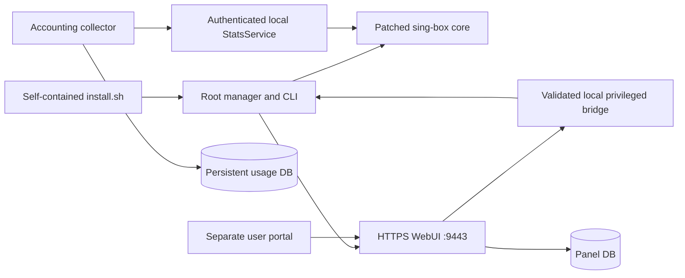

# Architecture

SBOX Next combines a server manager, authenticated web application and embedded VPN core. The installer contains these components and does not load a second application archive.

## Source map

| Path | Authoritative role |
| --- | --- |
| `src/install.template.sh` | Single-file wrapper, package validation, menu and secure product dispatch |
| `src/manager.sh` | Readable Generic manager template; assembly integrates shared features |
| `src/state.py`, `policy.py`, `security.py`, `performance.py` | State/export transactions and owned host controls |
| `src/snapshot_compare.inc`, `certificate_reuse.sh`, `unlock.py` | Shared recovery comparison, validated certificate reuse and secure envelope handling |
| `src/fallback-web/` | Universal-only self-hosted REALITY website: hardened loopback HTTPS server and the generated SBOX Personal Cloud site (`build_site.py`) |
| `src/helper-baselines/` | Public baseline helpers used to merge common changes with the private variant |
| `shared_webui/backend/` | HTTPS APIs, portal/auth, SQLite state, quotas, monitoring and backup validation |
| `shared_webui/privileged-bridge/` | Local root authorization and manager integration |
| `shared_webui/frontend-src/` | Editable admin/portal frontend source |
| `shared_webui/frontend/` | Deterministically assembled runtime frontend |
| `assets/` | Embedded core and authenticated encrypted compatibility envelope |
| `core-source/` | Corresponding modified-core source, pinned build and licenses |
| `tools/`, `tests/` | Build, validation, packaging and regression tooling |

Runtime configuration lives under `/etc/sbox-manager`, persistent data under `/var/lib/sbox-*`, and installed application code under `/usr/local/lib/sbox-*`. Preserve these paths and local lock names across matching upgrades.

The privileged bridge accepts bounded validated transactions rather than arbitrary shell commands. The core emits real authenticated payload statistics and supports managed-user connection closure. Panel/accounting data remain persistent across matching upgrades. Snapshot seals stay byte-exact; the one staging live-policy exception validates metadata, source, schema and managed identities before retaining a newer collector decision.

## Public and private builds

The public tree has complete common application and modified-core source. Ordinary assembly reuses the committed ZgoCloud ciphertext, producing the same complete installer offline. Owner resealing additionally needs the original private credential-bearing manager, exact original YAML and private unlock. Those materials stay outside Git; see [development](development.md).

The complete installer includes the application and core. Installation does not require a core compiler, a Git checkout or any GitHub access, and no runtime path downloads a core. Normal distribution packages (apt), ACME and DNS use the network.
